# LatinKit

Synthesized Latin percussion for Ableton Live: Max for Live instruments whose sounds are synthesized in Max (gen~) with modal, physical and particle models. Nothing is played back from samples. Many of the models were fitted to recordings of real instruments, so the timbres follow the originals.

## Instruments

| Folder | Instrument | Devices |
|---|---|---|
| `Agogo/` | Agogo bell, High and Low, Open and Mute strokes | `Agogo.amxd` |
| `Bongo/` | Bongo, Macho or Hembra, seven hand strokes | `Bongo.amxd` |
| `Caxixi/` | Woven-basket rattle (PhISEM particle model) | `Caxixi.amxd` |
| `Conga/` | Tumba, conga and quinto, six hand strokes each | `Conga.amxd`, `Conga Voice.amxd` (one drum, for Drum Rack pads) |
| `CR78/` | The Roland CR-78 voice board, modelled from its 1979 service notes | `CR78.amxd`, plus one device per voice |
| `Cuica/` | Friction drum, with MPE pressure | `Cuica.amxd` |
| `Ganza/` | Samba ganzá and chocalho | `Ganza.amxd` |
| `Guiro/` | Güiro and samba reco-reco | `Guiro.amxd` |
| `Pandeiro/` | Pandeiro and tamborim | `Pandeiro.amxd`, `PandeiroMusical.amxd` (the MIDI key sets the pitch) |
| `Repinique/` | Samba repinique | `Repinique.amxd` |
| `Shaker/` | Maraca, cabasa, shekere, ganzá/chocalho and egg shaker (PhISEM) | `Shaker.amxd` |
| `Surdo/` | Samba surdo, Open, Mute, Rim and Finger strokes | `Surdo.amxd`, `SurdoMusical.amxd` |
| `Timbales/` | Timbale built around the cáscara | `Timbales.amxd` |

Each folder's README has the note map, the controls and the notes on how the model was fitted.

## Panels

Each device as it looks in Live's device view.

<table>
<tr>
<td align="center">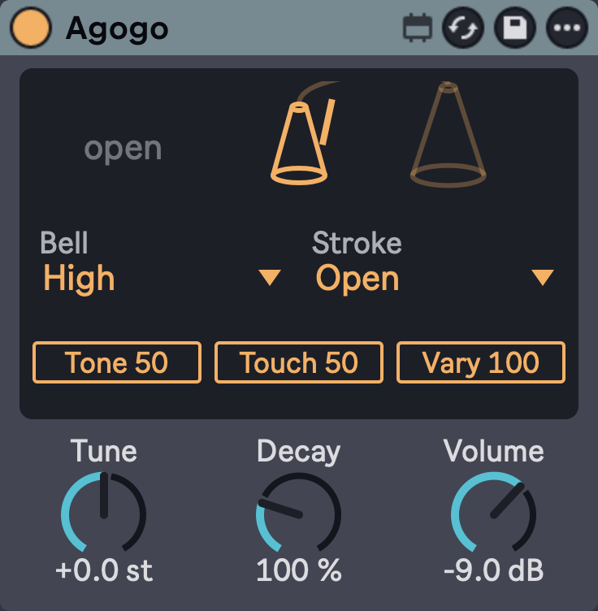 Agogo</td>
<td align="center">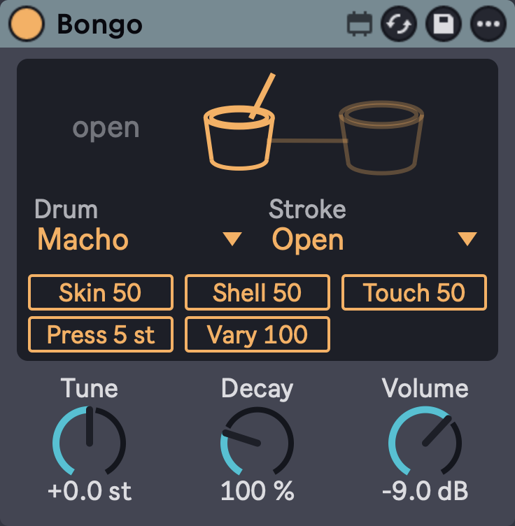 Bongo</td>
</tr>
<tr>
<td align="center">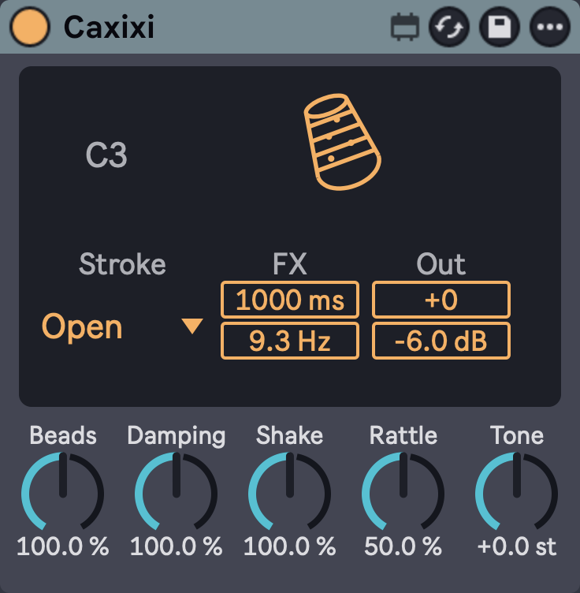 Caxixi</td>
<td align="center">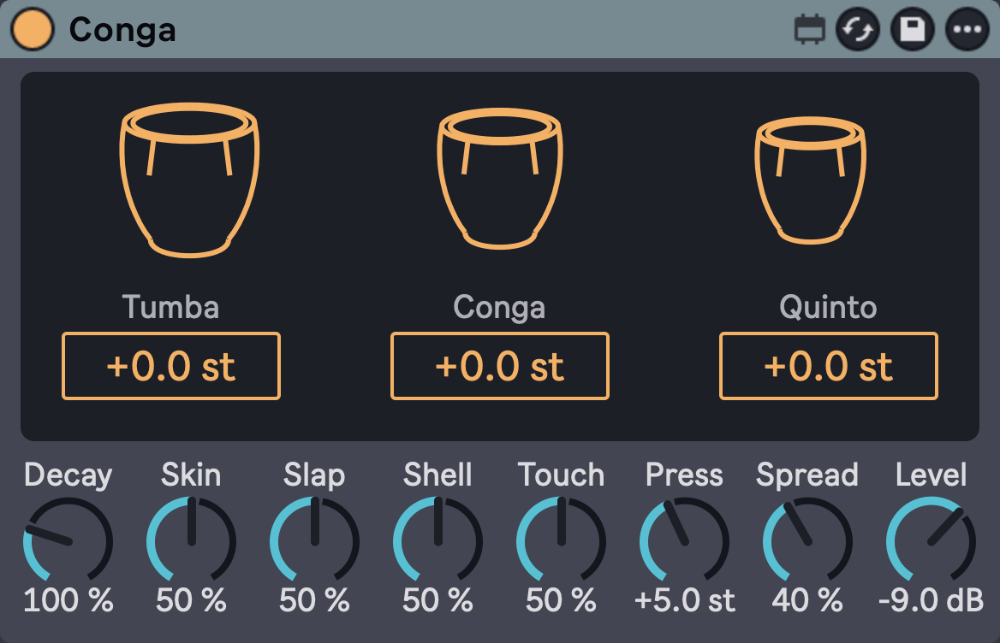 Conga</td>
</tr>
<tr>
<td align="center">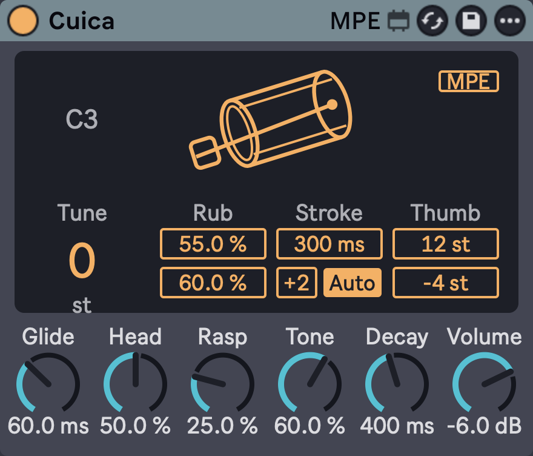 Cuica</td>
<td align="center">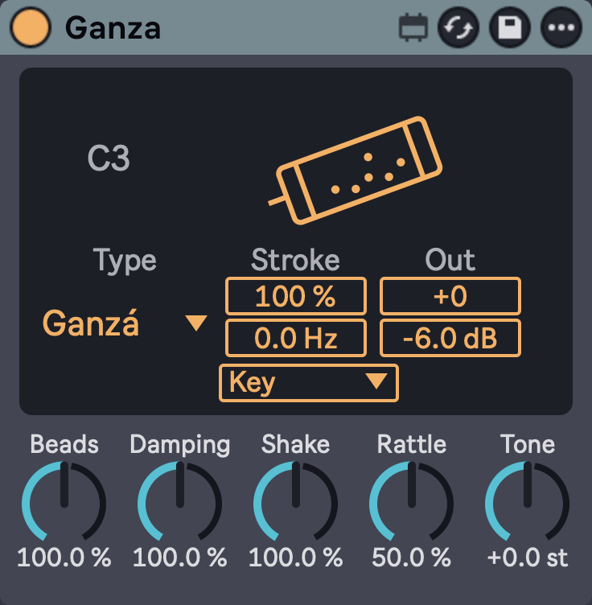 Ganzá</td>
</tr>
<tr>
<td align="center">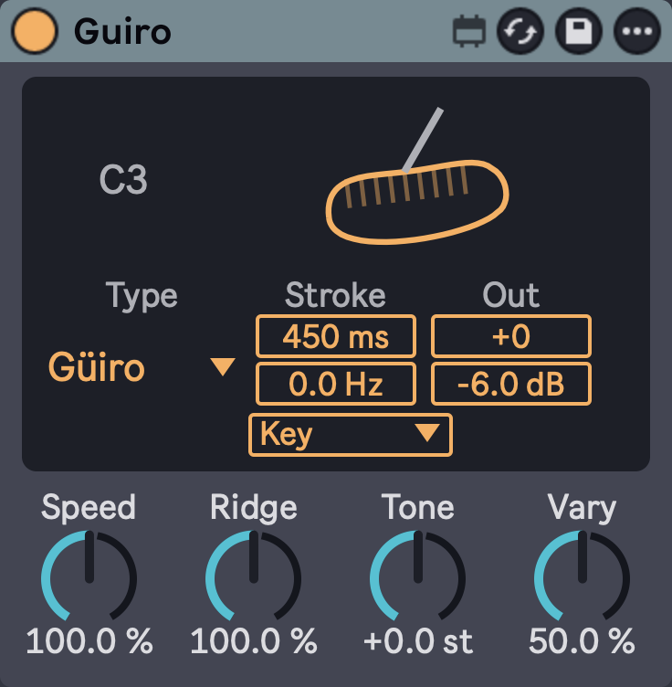 Güiro</td>
<td align="center">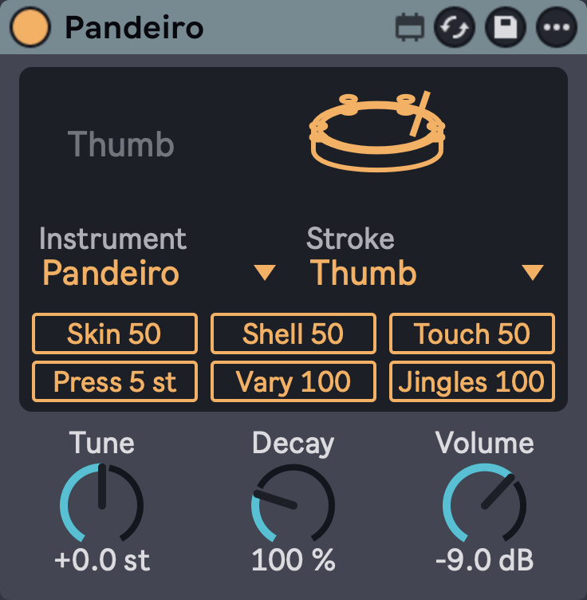 Pandeiro</td>
</tr>
<tr>
<td align="center">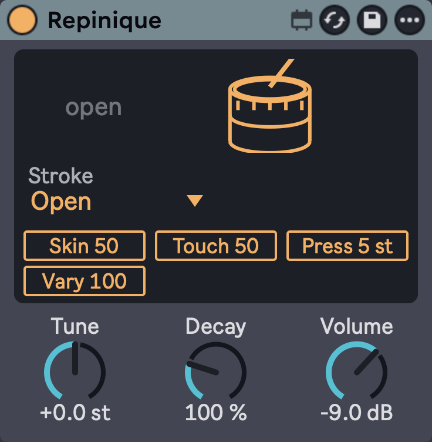 Repinique</td>
<td align="center">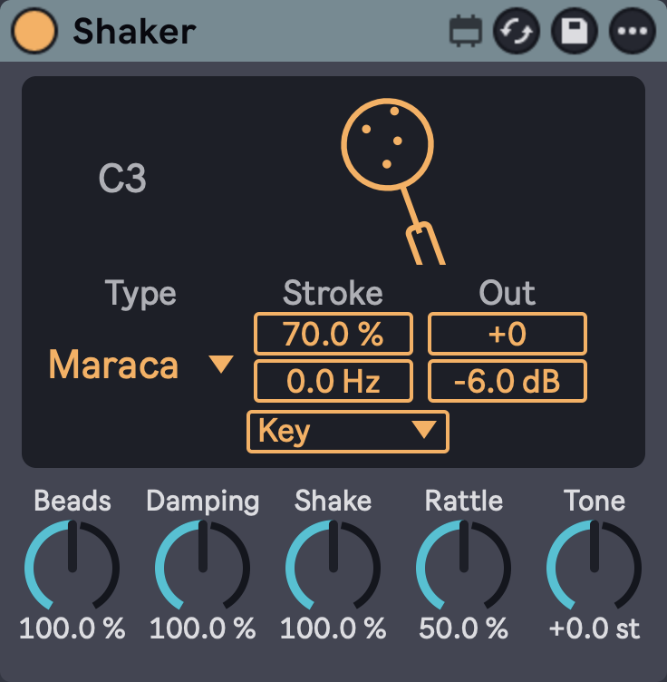 Shaker</td>
</tr>
<tr>
<td align="center">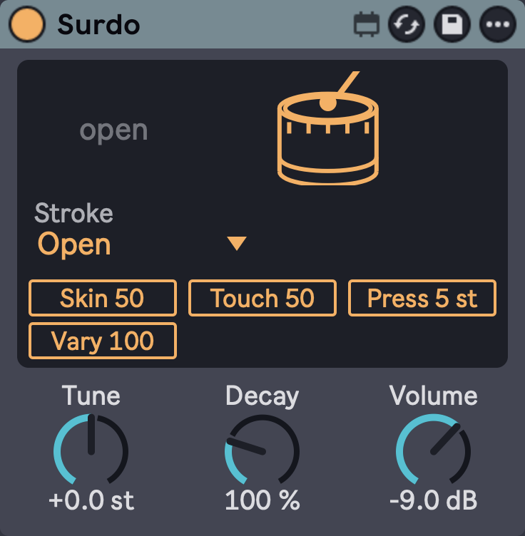 Surdo</td>
<td align="center">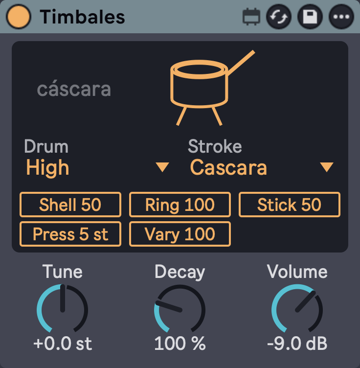 Timbales</td>
</tr>
</table>

The CR78's four pages:

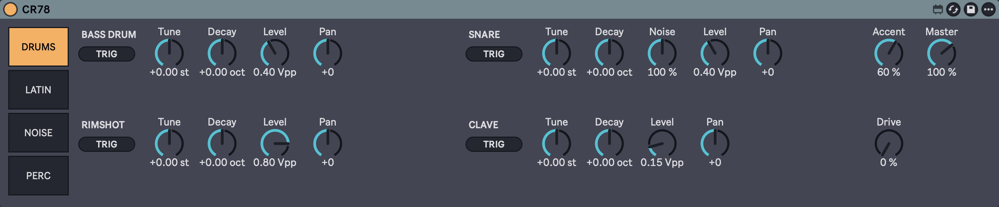 Drums

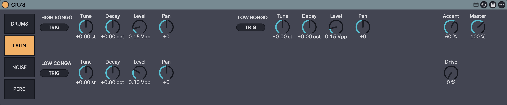 Latin

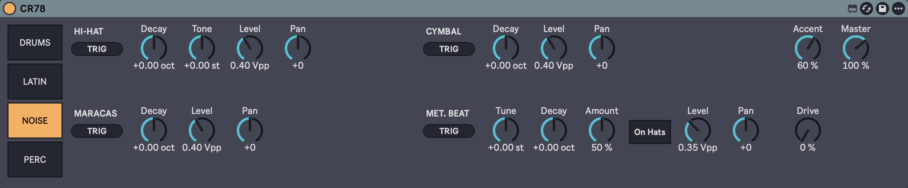 Noise

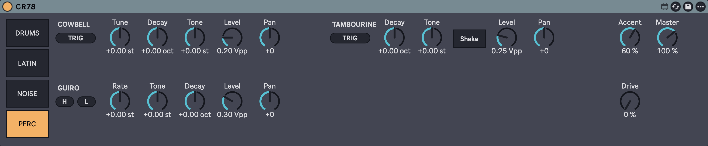 Perc

## Install

Built and tested in Ableton Live 12 with Max for Live.

1. Copy an instrument's `m4l/` folder anywhere in your User Library. Keep the `.js` files next to the `.amxd`: the device loads them from its own folder.
2. Drag the `.amxd` onto a MIDI track.

To install everything at once, `python3 make_kit.py` copies every device into your User Library and writes a `Latin Kit` Drum Rack preset with the pads mapped from C1 (default `~/Music/Ableton/User Library`; `--dest` for another).

## Building from source

Each device is generated: `scripts/build_maxpat.py` writes `m4l/<Name>.maxpat`, and `build.sh` checks it, runs the tests and packs the `.amxd`. Packing uses a helper (`MaxForLiveTools/build_amxd.py`) that isn't in this repository, which is why the built `.amxd` files are included. The tests that run in standalone Max use maxtest-mcp (set `MAXTEST_DIR` to its folder), and the scripts that fit the models to recordings read Ableton's Latin Percussion pack (set `LP_PACK`).

## License

MIT; see `LICENSE`.
